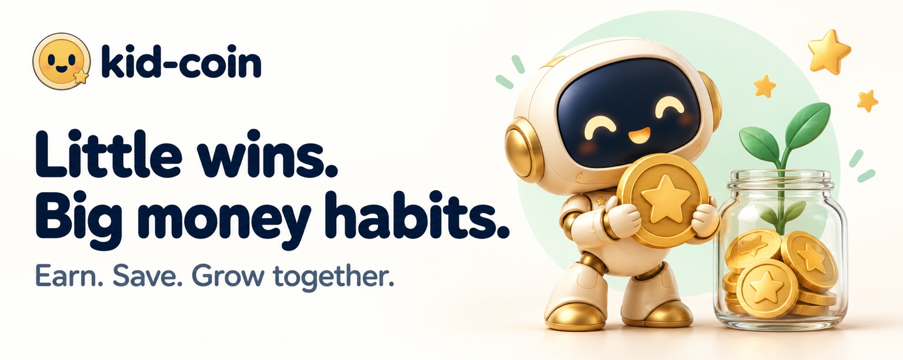

<p align="center">
  
</p>

# Kid Coin

**Little wins. Big money habits.**

Earn. Save. Grow together.



## A little responsibility. A moment of pride.

Imagine a child saving for a LEGO set. Today, they pack their backpack and help clear the table. They mark a task done, a parent approves it, and a few coins bring that LEGO set closer. Tomorrow, there is a choice: spend on a small reward now, or keep working toward something bigger.

That small decision is where Kid Coin begins.

Kid Coin is a family web app that turns everyday effort into visible progress. Children practice responsibility, patience, and making choices. Parents set clear expectations and meaningful rewards. The moment we want to create is simple: **“I did this myself.”**

> Our vision: help kids become more independent and thoughtful with money through everyday accomplishments.

## Built for kids. Guided by parents.

Our initial focus is families with children **ages 6–10**, within the broader 5–12 audience described in the [product brief](PRODUCT.md).

For a child, three things should be obvious: what can I do today, what have I earned, and what am I working toward? For a parent, assigning tasks and approving progress should fit into an ordinary busy day.

Rewards can be a toy, choosing dinner, or special time together. Coins are virtual, and parents decide what they mean for their family. Real-money transfers are outside the MVP.

Families should also decide which activities earn coins. Helping at home and caring for yourself can be responsibilities in their own right; every act of kindness does not need a price tag.

## The MVP: one complete family journey

**Assign a task → submit completion → parent approves → earn coins → request a reward → parent approves and delivers it.**

| Step | What the family needs |
| --- | --- |
| Set up | A parent account, child profiles, and a profile picker for a shared device |
| Assign | Tasks with a title, coin value, and daily or one-time schedule |
| Complete | A child can see today's tasks and submit completed work |
| Approve | A parent can approve a task or return it for another try |
| Earn | Clear balances and a simple history of coins earned and spent |
| Redeem | Rewards with fixed coin prices, parent approval, and clear fulfillment tracking |

Trust is part of the MVP. The release target includes awarding coins only after approval, accounting for pending reward requests, preventing duplicate awards and overspending, and making every balance change understandable.

### Target plan

These are release goals, not claims of completed validation.

1. **Finish and verify the core journey.** Walk through setup, daily tasks, approvals, coin history, redemption, and fulfillment as both parent and child. Resolve gaps before expanding the experience.
2. **Make the first five minutes easy.** Target: a parent creates a child profile, three tasks, and one reward within five minutes. A child understands the next action without a tutorial.
3. **Try it with 3–5 families for two weeks.** Look for repeated task completion, at least one completed reward cycle per family, and parents finding approvals easy enough to maintain.
4. **Improve from family feedback.** Prioritize confusing steps, repeated reminders, accessibility, and reliability before adding more features.

Success means a routine needs fewer reminders, a child feels proud of a reward they earned, and a parent wants to keep using the app. Time spent in the app can stay low.

## Project status

**MVP in active development · package version 0.1.0**

The repository has substantial implementation beyond the original concept. The immediate priority is to verify and simplify the core family journey for a small pilot.

| Area | Current repository state |
| --- | --- |
| Family access | Signup, login, profile selection, child sessions, and parent PIN routes are present |
| Tasks and approvals | Parent task management, kid task screens, completion submission, and approval/decline routes are present |
| Coins and rewards | Balance helpers, reward management, redemption requests, and approval/decline routes are present |
| Beyond the MVP | Savings-jar allocation, withdrawal, interest accrual, and character customization code are present; these do not expand the first-release commitment |
| Design and testing | Design-system components, Storybook stories, Vitest tests, and Playwright specs are included; GitHub Actions is configured to build and run unit tests |
| Pilot readiness | End-to-end release verification, fulfillment tracking, onboarding usability, and family-pilot results remain release targets |

This status describes source code and configuration. It does not assert that a production deployment, current CI run, or family pilot has been verified.

**Naming note:** the repository is `kid-coins`; existing product documents, screens, and internal identifiers use **Earnie**. This README introduces the supplied **Kid Coin** branding. Updating the application branding is separate work.

## Beyond the first little win

Once the core loop earns families' trust, Kid Coin can grow with the child. These are future directions rather than promised release dates.

| Direction | What it could unlock |
| --- | --- |
| Savings goals and jars | Let children choose a goal and practice setting coins aside; refine the existing jar implementation through family feedback |
| Better routines | Add flexible schedules, responsibility-only tasks, and gentle reminders without requiring coins for every activity |
| A growing companion | Build on character customization with milestone celebrations that recognize effort and welcome kids back after a break |
| Parent planning assistance | Help parents turn “make mornings easier” into an age-appropriate routine; parents review suggestions and control rewards |
| Family reflection | Offer a short weekly review of accomplishments, choices, and what to adjust together |
| Everyday money lessons | Introduce saving, spending, giving, and tradeoffs when a child's own decisions make them relevant |

AI coaching, elaborate character progression, advanced analytics, and real-money integrations are outside the MVP. Some supporting code already exists; the release scope stays focused on tasks, coins, and parent-approved rewards.

## For builders

Kid Coin uses **Next.js 16 and React 19**, **TypeScript**, **Tailwind CSS v4**, and **Framer Motion**. Data lives in **Supabase Postgres** through **Drizzle ORM**, with **Supabase Auth** for parent accounts. The repository also includes Anthropic SDK and PostHog integrations.

### Run locally

Use Node.js 22 (matching CI) and pnpm 9.

```bash
pnpm install --frozen-lockfile
cp .env.example .env.local
```

Fill in the Supabase and database settings in `.env.local` using a development Supabase project. The example file also documents Anthropic, PostHog, and savings-jar cron settings for those integrations. Keep service-role credentials on the server.

```bash
pnpm db:migrate
pnpm dev
```

Open [localhost:3000](http://localhost:3000).

| Command | Purpose |
| --- | --- |
| `pnpm build` | Create a production build |
| `pnpm test:run` | Run Vitest tests |
| `pnpm test:e2e` | Run Playwright tests; see [configuration](playwright.config.ts) for server setup |
| `pnpm storybook` | Explore the component library |

### Explore the project

- [Product purpose and principles](PRODUCT.md)
- [Design system](DESIGN.md)
- [Visual handoff and screen prototypes](design_handoff_earnie/README.md)
- [Task and reward implementation plan](docs/PLAN-task-reward-system.md)
- [Contributor and agent guide](AGENTS.md)

Feature branches start from `develop` and return through a pull request. Read the contributor guide and relevant repository skills before changing application code.

Original design inspiration: [Kids Educational App Branding](https://dribbble.com/shots/27139208-Kids-Educational-App-Branding).
